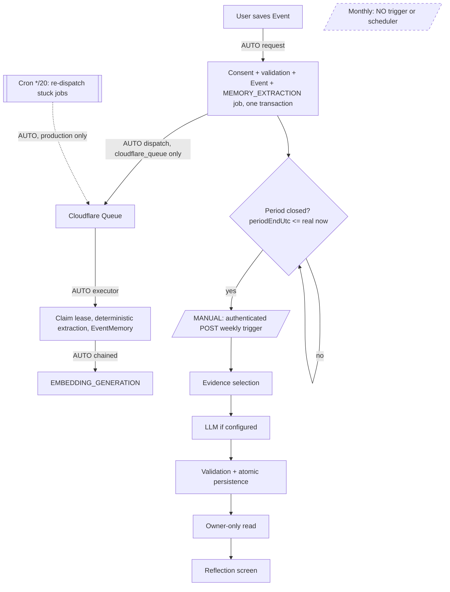
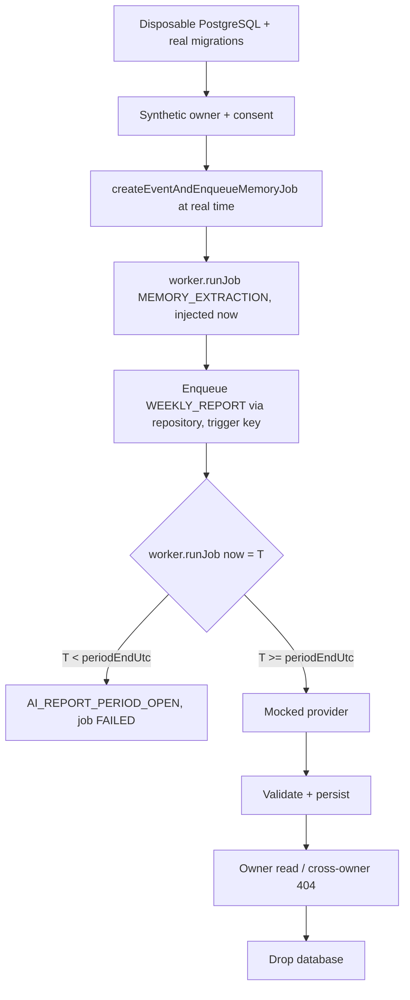
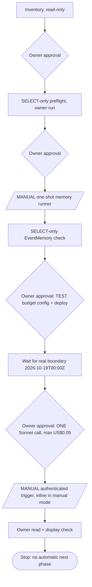

# PetalPal — Real-Time and Simulated-Time Workflow Test Plan

Plan for proving the Event → Memory → Weekly/Monthly Report lifecycle, both
naturally (real time) and immediately (simulated evaluation time). Time rules
are defined in [time.md](../../time.md). This document **does not authorize**
any execution; every phase has its own approval gate (§8).

Read first: [WARNING.md](../../WARNING.md), [AGENTS.md](../../AGENTS.md),
[CLAUDE.md](../../CLAUDE.md), [INTEGRATION_DEPLOYMENT.md](../../INTEGRATION_DEPLOYMENT.md),
[docs/ai/REFLECTION_V2.md](../ai/REFLECTION_V2.md).

Per-language (en / zh-Hans) evidence: [BILINGUAL_WEEKLY_ACCEPTANCE.md](BILINGUAL_WEEKLY_ACCEPTANCE.md).
`ai-p0.postgres` real-PostgreSQL suite: 17/17 locally on 2026-10-17 after
fixture-only consent-seed fixes (details there).

Status labels: **VERIFIED** (source + cited test or recorded run) ·
**IMPLEMENTED BUT UNTESTED** · **PROPOSED** · **NOT SUPPORTED**.
"Recorded" evidence was reported by the owner or written in repository docs and
was not re-run for this plan.

## 1. Baseline (2026-10-17)

| Item | Status | Evidence |
|---|---|---|
| TEST Web Build #9 / Deploy #5 / Activate #6 | VERIFIED (recorded) | Owner-reported workflow results |
| TEST backend `01b1bc2d` Live | VERIFIED (recorded) | Owner-reported Render state |
| Consent fix (PR #70) saves all three flags | VERIFIED | `mobile/test/privacyControls.test.mjs`; hosted save recorded |
| 2 synthetic Chinese Events, localDate 2026-10-17, owner timezone UTC | VERIFIED (recorded) | Owner-run read-only preflight |
| Exactly 2 PENDING memory jobs, memory consent on, 0 Weekly jobs | VERIFIED (recorded) | `scripts/integration-memory-preflight.mjs` output |
| One-shot memory run `{"SUCCEEDED":2}; provider calls 0` | VERIFIED (recorded) | `scripts/integration-memory-run-once.mjs` output |
| Hosted EventMemory rows and their source references | NOT VERIFIED | — |
| Hosted Weekly report for week 2026-10-12 | NOT VERIFIED (not generated) | — |
| Automatic memory processing on hosted TEST | NOT SUPPORTED | TEST guard forbids dispatch/executor credentials |
| Automatic Weekly/Monthly scheduling (any environment) | NOT SUPPORTED | No scheduler or caller in source (§3) |
| TEST paid AI | Disabled (call limits 0 unless `PETALPAL_TEST_AI_BUDGET` opt-in) | `lib/integration-environment.js` |

**Prior evidence (preserved, not re-run):**
- Isolated real-Sonnet zh-Hans Weekly v2 acceptance on 2026-10-15
  ([REFLECTION_V2.md](../ai/REFLECTION_V2.md)); PR #62 recorded 8/8 real Sonnet
  calls and 4/4 blind wins.
- Disposable-PostgreSQL validation of the memory runner (2026-10-16).
- Production Queue cutover observation (LONG_TERM_AI.md §12, 2026-09-29).

## 2. Independent dimensions

A test result proves only its own cell. Manual execution is not proof of
automation, and mocked inference is not proof of model quality.

| Dimension | Options |
|---|---|
| Clock | Real system time · injected application time (`now`/`asOf`/`occurredAt` at library level; no HTTP override) |
| Data | Synthetic fixtures in disposable PostgreSQL · synthetic Events in hosted TEST · Production data (never copied into fixtures) |
| Execution | Manual one-shot runner · background dispatch (Queue + executor) · scheduler (cron re-dispatch only; **no report scheduler**) |
| AI | Deterministic memory extraction · mocked provider · real Sonnet/Opus with explicit budget approval |
| Environment | Disposable local · hosted TEST · Production |

## 3. Production workflow map

| # | Transition | Code | Trigger | Auto/Manual | Config | Statuses | Failure / retry / idempotency | Tests | Not verified |
|---|---|---|---|---|---|---|---|---|---|
| 1 | Save Event | `POST /events` → `createEventAndEnqueueMemoryJob` ([lib/ai-jobs.js](../../lib/ai-jobs.js)) | User | Auto (request) | Auth, consent row | 201 created / 200 replay | Idempotency-Key; same-key race replays (P2002 fix); content check before tx | `ai-event.route`, `ai-p0.postgres` race, `event-transaction-content-check` | — |
| 2 | Consent + validation | Same transaction: `AiConsent FOR SHARE`, owner, content | Step 1 | Auto | Full consent for memory | `memoryProcessingAllowed` | No job without full consent | `ai-event.route`, `ai-consent-lifecycle` | — |
| 3 | Memory job queued | Same transaction (`MEMORY_EXTRACTION`, PENDING) | Step 1 | Auto | — | PENDING | Atomic with Event | `ai-p0.postgres`; hosted TEST recorded | — |
| 4 | Dispatch | `dispatchAiJob` → Cloudflare dispatch Worker → Queue ([lib/ai-async-dispatch.js](../../lib/ai-async-dispatch.js), [cloudflare-worker](../../cloudflare-worker/src/index.js)) | After Event commit | Auto in `cloudflare_queue`; none in `manual` | `AI_JOB_DISPATCH_URL/TOKEN` | queued | Queue `max_retries: 3`; cron `*/20` re-dispatch (production only) | `ai-async-dispatch(.postgres)`; prod observation recorded | Hosted TEST: NOT SUPPORTED |
| 5 | Claim + execute | `/internal/ai-jobs/:id/execute` → `executeAiJobById` → `runJob` / `claimById` | Queue message / cron / manual runner | Auto (prod), manual (TEST) | `AI_JOB_EXECUTOR_TOKEN` | RUNNING → SUCCEEDED / PENDING (retry) / FAILED | Lease + heartbeat; expired lease reclaimed; `maxAttempts` | `ai-worker-lifecycle`, `ai-p0.postgres` crash/lease | Auto path on hosted TEST |
| 6 | Memory extraction + persist | `DeterministicMemoryExtractor`, `PrismaMemoryRepository` ([lib/event-memory.js](../../lib/event-memory.js)) | Step 5 | — | Consent locked | EventMemory row; EMBEDDING job PENDING | Consent re-checked; `CONSENT_INELIGIBLE` skip | `ai-p0.postgres`; runner validation | Hosted EventMemory rows |
| 7 | Embedding | `EMBEDDING_GENERATION` chained via `nextJobId` | Step 6 | Auto (prod) | Cloudflare BGE | SUCCEEDED | Idempotent per memory | `ai-p0.postgres` embedding | Hosted TEST: NOT SUPPORTED (zh-Hans path does not need it) |
| 8 | Period determination | `occurredAt` + `User.timezone` ([lib/ai-periods.js](../../lib/ai-periods.js)) | Data | Auto | — | periodKey | — | `ai-p0.integration`, `vancouver-timezone` | — |
| 9 | Period closes | Real clock | Time | Auto | — | COMPLETE | Open → `AI_REPORT_PERIOD_OPEN` | `ai-p0.integration` | — |
| 10 | Weekly job created | `POST /ai/reports/weekly/trigger` | Authenticated API call | **Manual** (no UI caller, no scheduler) | Memory consent | 202/200/502/429 | Key `WEEKLY_REPORT:<periodKey>:<version>`; `maxAttempts: 1` | `ai-event.route`, `private-report-list` | Automatic Weekly: NOT SUPPORTED |
| 10m | Monthly job created | No route | — | NOT SUPPORTED | — | — | — | Library only (`opus-monthly`, `report-worker`) | — |
| 11 | Evidence selection | `ReportInputService` ([lib/report-foundation.js](../../lib/report-foundation.js)); zh: EventMemory; en: BGE/pgvector | Step 10 | Auto | Locale | READY / INSUFFICIENT_EVIDENCE (min 2) | Source fence (`REPORT_SOURCE_STALE`) | `weekly-evidence-selector-v2`, `weekly-evidence-significance` | Hosted |
| 12 | LLM generation | `SonnetWeeklyReflectionService` ([lib/sonnet-weekly.js](../../lib/sonnet-weekly.js)); default `workers-ai` | Step 11 | Auto (inline in manual mode) | Weekly provider/model/contract, Gateway, USD + call limits | GENERATED / failure codes | Cost reservation, replay block, no retry on ambiguous charge | `sonnet-weekly`, `reflection-v2`; real isolated acceptance recorded | Hosted TEST real call |
| 13 | Schema/grounding/privacy validation | `validateWeeklyReflectionV2`, gateway schema | Step 12 | Auto | — | pass / `AI_GATEWAY_GROUNDING_FAILED` | Fails closed | `reflection-v2`, `sonnet-weekly` | — |
| 14 | Atomic persistence | `GroundedReportPersistenceService`, write fence ([lib/report-write-fence.js](../../lib/report-write-fence.js)) | Step 13 | Auto | — | WeeklyReport + AiEvidence | Unique `(ownerId, periodKey)`; finalized short-circuit | `report-write-fence`, `report-worker`, `ai-p0.postgres` | Hosted |
| 15 | Owner-only read | `GET /ai/reports`, `GET /ai/reports/:type/:id` | User | Auto | Memory consent | 200 / 403 / 404 | Owner-scoped | `private-report-list`; hosted Phase A negatives VERIFIED (run 38991251290) | Hosted positive read |
| 16 | Display | [mobile/src/app/reflection.tsx](../../mobile/src/app/reflection.tsx) | User | Auto | — | List/detail | — | — | Hosted display |

## 4. Diagrams

### 4.1 Natural real-time lifecycle (production design)

### 4.2 Simulated-time local lifecycle (Workflows A/B/E1)

### 4.3 Hosted TEST approval and execution workflow

## 5. Workflows

### A — Simulated clock, offline ($0) — mostly VERIFIED

Pure functions and mocked repositories with injected `now`/`asOf`. Existing:
`ai-p0.integration` (Vancouver dates, Sunday/Monday, DST 167h, month bounds,
open/partial), `vancouver-timezone` (permanent UTC-7), `report-worker` (injected
`now`), `ai-consent-lifecycle`, `sonnet-weekly`, `opus-monthly`, `reflection-v2`.
Gaps to add (PROPOSED): exact `periodEndUtc − 1ms` / `== periodEndUtc` /
`+1ms`; UTC week vs Vancouver week for the same instant; year transition
(Dec→Jan Monthly, ISO week spanning the new year); fall-back 169h week in a zone
that still observes DST (for example `America/New_York` 2026-11-01); device
zone ≠ account zone (dates follow `User.timezone`); `AI_REPORT_PERIOD_OPEN`
without job creation at the route.

### B — Full simulated-time integration ($0) — PROPOSED

Disposable PostgreSQL, `prisma migrate deploy`, real deterministic extraction,
mocked AI. No OS clock change and no backdated Events.
1. Seed 2 owners (UTC); full consent for owner A.
2. Create 2 Events for A at real time (`occurredAt` = now) and 1 for B.
3. `runJob` MEMORY_EXTRACTION for A → expect 2 SUCCEEDED, 2 EventMemory
   (`ownerId`=A, `sourceEventId` matches, `eventDate = occurredAt`), 2 EMBEDDING PENDING.
4. Enqueue WEEKLY_REPORT for A's `periodKey` via `PrismaAiJobRepository`.
5. `runJob` with injected `now` (see E) and a mocked gateway.
6. Expect one WeeklyReport `(A, periodKey)`, AiEvidence citing only A's
   memories; B untouched; second enqueue returns the same job; read as B → 404.
7. Revoke A's consent → reports/memories deleted (current semantics); jobs CANCELLED.
8. Drop the database.

### C — Hosted TEST, real time, manual

| Step | Status |
|---|---|
| Consent saved (3 flags) | PASS (recorded) |
| 2 Events, localDate 2026-10-17 | PASS (recorded) |
| 2 PENDING jobs, read-only preflight | PASS (recorded) |
| One-shot runner `SUCCEEDED: 2`, 0 provider calls | PASS (recorded) |
| EventMemory persisted, owner/source references match, in week 2026-10-12 | NOT VERIFIED |
| No duplicate memories, no unrelated or cross-owner jobs | NOT VERIFIED |

Next (PROPOSED, SELECT-only, owner-run, extend
`scripts/integration-memory-preflight.mjs` or a sibling): print counts and
booleans only. Expected: memory rows for the owner = 2; each
`memory.ownerId = owner` and `memory.sourceEventId ∈ owner's Events`; distinct
`sourceEventId` = 2; every `eventDate` within
`[2026-10-12T00:00Z, 2026-10-19T00:00Z)`; MEMORY_EXTRACTION SUCCEEDED = 2,
PENDING = 0; EMBEDDING PENDING ≤ 2; WEEKLY_REPORT = 0. Do not rerun the runner.

### D — Hosted TEST, real time, automatic — NOT SUPPORTED today

| Capability | Exists? | Gap |
|---|---|---|
| Event auto-queues job | Yes (all envs) | — |
| Worker auto-claims | Production only (`cloudflare_queue`) | TEST guard forbids dispatch/executor credentials; staging Queue has no cron |
| Safe retry | Yes (lease, `maxAttempts`, Queue retries) | Not exercised on hosted TEST |
| Duplicate dispatch → one memory | Yes (claim + unique memory per Event) | Not exercised hosted |
| Revocation stops processing | Yes (consent re-check, CANCELLED) | Not exercised hosted |
| Period close triggers report | **No** | No scheduler; trigger is API-only |
| User reads own report | Yes | Hosted positive read unverified |

Running D requires a separately approved design: a TEST dispatch/executor lane
wired to the staging Queue, TEST-only credentials, and a guard change. Nothing
here enables it.

### E — Weekly/Monthly without waiting

Scenario: Events at 2026-10-17 (UTC), period `[2026-10-12T00:00Z, 2026-10-19T00:00Z)`.

| Evaluation time | Result |
|---|---|
| Real time before close (today, 2026-10-17) | REJECT: route 400 `AI_REPORT_PERIOD_OPEN`, no job |
| Simulated `2026-10-18T23:59:59Z` | REJECT: worker throws `AI_REPORT_PERIOD_OPEN` at `asOf` |
| Simulated `2026-10-19T00:00:00Z` | ELIGIBLE (`periodEndUtc ≤ asOf`), if consent, ≥2 evidence, cost and config gates pass |

Eligibility only means the period gate passed. Generation can still fail on
evidence, provider configuration, budget, timeout or grounding.

| Option | Fidelity | Risk | Status |
|---|---|---|---|
| E1 Disposable synthetic run, injected worker `now` | Production pipeline minus HTTP trigger and real provider | None to hosted data | Library support exists; harness PROPOSED |
| E2 Isolated integration runner (real Sonnet, disposable DB, fixture history), as in `zh-reflection-v2-weekly-acceptance.mjs` | Real model, production pipeline | Paid call (approved separately) | VERIFIED pattern (2026-10-15) |
| E3 Hosted TEST simulated clock | Highest environmental fidelity | New override surface in a hosted service | PROPOSED, **not recommended** |

**Recommendation:** E1 now ($0), then E2 only if new model evidence is needed.
For hosted TEST, use the real boundary instead of a clock override: week
2026-10-12 closes at **2026-10-19T00:00Z** (Sunday 17:00 Vancouver), about
1.5 days away. E3 should be built only if a hosted-only defect needs it, under
`time.md` §7 constraints.

### F — Real Sonnet Weekly acceptance (hosted TEST) — PROPOSED

Preconditions, each confirmed read-only: Workflow C memory checks PASS; owner
`preferredLocale = zh-Hans`; owner timezone UTC; target `periodKey 2026-10-12`;
real time ≥ 2026-10-19T00:00Z; no existing WEEKLY_REPORT job for that key.
Configuration (owner-entered; separate approval and TEST deploy):
`PETALPAL_TEST_AI_BUDGET=weekly-sonnet-v1`, call limits 1, Weekly
`anthropic`/`claude-sonnet-5-5`/`weekly-reflection-v2`, TEST Gateway
`petalpal-integration`, all USD caps ≤ 0.05 (reservation US$0.04096).
Execution: exactly one authenticated trigger with
`{ "localDate": "2026-10-17" }` (never an empty body); `maxAttempts: 1`; **no
retry** on any failure. Record status, error code, report id presence, evidence
count and cost metadata. Verify grounding, citations to the 2 memories,
Chinese fluency and no invented facts by human review. Then remove the budget
configuration. Monthly/Opus needs its own plan, budget (reservation ≈ US$0.164)
and approval, never bundled with Weekly.

### F2 — Short Weekly report `weekly-short-v1` (hosted TEST) — PREPARED 2026-10-20

Week 2026-10-12 was consumed by F on 2026-10-19, so F2 targets week **2026-10-19**
(trigger `{ "localDate": "2026-10-24" }`, real time ≥ **2026-10-26T00:00Z**). Its Events must be
written during that week (server `occurredAt`, no backdating); "then and now" reaches the
four earlier weeks (from 2026-09-21T00:00Z), so a phrase repeated from the 2026-10-16/17
hosted Events can pair. Same budget as F with `AI_WEEKLY_REFLECTION_CONTRACT=weekly-short-v1`.
Steps and approvals: [WEEKLY_SHORT_TEST_ACCEPTANCE.md](WEEKLY_SHORT_TEST_ACCEPTANCE.md).

## 6. Test matrix

| ID | Env | Time | Data | Exec | AI | DB writes | Expected | Status | Evidence | Approval |
|---|---|---|---|---|---|---|---|---|---|---|
| A1 | Local | Sim | Fixture | Auto test | — | No | Vancouver dates, DST 167h, month bounds | VERIFIED | `ai-p0.integration` | None |
| A2 | Local | Sim | Fixture | Auto test | — | No | BC permanent UTC-7 | VERIFIED | `vancouver-timezone` | None |
| A3 | Local | Sim | Fixture | Auto test | — | No | close −1ms reject / =close eligible / +1ms | PROPOSED | — | Code change |
| A4 | Local | Sim | Fixture | Auto test | — | No | Year transition, fall-back 169h | PROPOSED | — | Code change |
| A5 | Local | Sim | Fixture | Auto test | Mock | No | Revoked consent → no job / report | VERIFIED | `ai-consent-lifecycle` | None |
| A6 | Local | Sim | Fixture | Auto test | Mock | No | <2 evidence → INSUFFICIENT_EVIDENCE | VERIFIED | `sonnet-weekly`, `report-worker` | None |
| B1 | Disposable PG | Real+Sim | Synthetic | Auto test | Mock | Disposable | Event → Memory → Weekly persisted, owner-only | PROPOSED | — | Code change |
| B2 | Disposable PG | Sim | Synthetic | Auto test | Mock | Disposable | Repeat enqueue → same job; finalized short-circuit | VERIFIED (lib) / PROPOSED (E2E) | `ai-p0.postgres` report idempotency | Code change |
| B3 | Disposable PG | Real | Synthetic | Auto test | — | Disposable | Worker crash → lease recovery, one memory | VERIFIED | `ai-p0.postgres` | None |
| B4 | Disposable PG | Real | Synthetic | Auto test | — | Disposable | Same-key Event race → one Event/job | VERIFIED | `ai-p0.postgres` | None |
| C1 | Hosted TEST | Real | Hosted synthetic | Manual | — | Yes (done) | 2 Events, 2 PENDING | PASS (recorded) | preflight | Done |
| C2 | Hosted TEST | Real | Hosted synthetic | Manual | Deterministic | Yes (done) | 2 SUCCEEDED, 0 provider calls | PASS (recorded) | runner output | Done |
| C3 | Hosted TEST | Real | Hosted synthetic | Manual | — | No | EventMemory = 2, references and week correct | NOT VERIFIED | — | Read-only check |
| C4 | Hosted TEST | Real | Hosted | Manual | — | No | Phase A negatives (401/403/400) | VERIFIED | run 38991251290 | Done |
| C5 | Hosted TEST | Real | Hosted | Manual | — | Possible | Re-run runner → "No pending" | NOT RUN (do not repeat) | — | — |
| D1 | Hosted TEST | Real | Hosted | Automatic | — | Yes | Event auto-processed | NOT SUPPORTED | Guard | Design + approval |
| D2 | Hosted TEST | Real | Hosted | Automatic | — | Yes | Period close → report | NOT SUPPORTED | No scheduler | Design + approval |
| E1a | Disposable PG | Sim 23:59:59Z | Synthetic (real Event→Memory) | Auto test | Mock | Disposable | REJECT: job FAILED, `AI_GATEWAY_INVALID_INPUT`, 0 provider calls, reservation still counted | VERIFIED 2026-10-17 | `weekly-zh-time-boundary.postgres` (fresh DB via `WEEKLY_BOUNDARY_DATABASE_URL`) | None |
| E1b | Disposable PG | Sim 00:00:00Z | Synthetic (real Event→Memory) | Auto test | Mock | Disposable | One mocked call, grounded zh-Hans report, owner-only, repeat reuses job | VERIFIED 2026-10-17 | `weekly-zh-time-boundary.postgres`, TEST runbook budget env | None |
| E2 | Disposable PG | Fixture history | Synthetic | Manual | Real Sonnet | Disposable | Grounded zh-Hans report | VERIFIED (recorded 2026-10-15) | REFLECTION_V2.md | Paid-call approval |
| E-route | Hosted TEST | Real (before close) | Hosted | Manual | — | No | 400 open period, no job | IMPLEMENTED BUT UNTESTED (hosted) | route code | Read-only call |
| F1 | Hosted TEST | Real ≥ close | Hosted synthetic | Manual | Real Sonnet ×1 | Yes | Report persisted, grounded | PROPOSED | — | Config + deploy + 1 call ≤ US$0.05 |
| F2 | Hosted TEST | Real | Hosted | Manual | — | No | Owner reads report; other owner 404 | PROPOSED | — | After F1 |
| F3 | Hosted TEST | Real | Hosted | Manual | — | Yes | Second trigger → existing job/report, no charge | PROPOSED | — | Separate approval |
| G1 | Web/Mobile | Real | Hosted | Manual | — | No | Reflection screen shows report | PROPOSED | — | After F2 |

## 7. Recovery notes

- A `FAILED` Weekly job is terminal for `(owner, periodKey, version)`; on
  hosted TEST use the next week, never edit rows.
- Revoking memory consent deletes the owner's reports, evidence and memories
  (current semantics); do not revoke on hosted TEST to "reset".
- Disposable databases are dropped after each run; hosted synthetic data stays.

## 8. Execution phases and gates

No phase authorizes the next. **STOP** on any unexpected status, count, host,
SHA, charge or write.

| Phase | Prerequisites | Actions | Expected evidence | PASS / FAIL | Recovery | STOP if |
|---|---|---|---|---|---|---|
| P0 Inventory | — | Read source/tests/docs | This plan, time.md | Complete map / gaps listed | — | Source contradicts docs |
| P1 Docs + offline | P0 | Add A3/A4 tests | `node --test` output | All pass / any fail | Revert test | Change touches runtime |
| P2 Disposable PG | P1 | B1, B2, E1a/E1b | Test output, dropped DB | Assertions pass | Drop DB | Needs hosted data |
| P3 Hosted read-only | Owner approval | C3 SELECT-only check | Counts/booleans | C3 expectations | None (read-only) | Any non-SELECT; unexpected counts |
| P4 Isolated sim E2E | P2 | E2-style run, mocked or approved real | Report + evidence | Grounded output | Drop DB | Paid call without approval |
| P5 Hosted manual lifecycle | P3 + approval | F1 prerequisites only (config, deploy) | Deploy ID, guard PASS | Guard PASS, no calls | Remove config | Guard FAIL; wrong SHA |
| P6 Automatic processing | Design + approval | D1/D2 | Job transitions | Auto claim proven | Disable lane | Not implemented → stays NOT SUPPORTED |
| P7 One Sonnet call | P5 + real time ≥ close + approval | F1 once | Sanitized result, cost | Report persisted, ≤ US$0.05 | Remove budget; no retry | Any failure or second call |
| P8 Read + display | P7 | F2, G1 | Status codes, screenshot without private text | Owner-only, renders | — | Cross-owner data |
| P9 Production readiness | P8 | Assessment only | Written gaps | — | — | Any Production write |

## 9. Maintenance

Changes to Event time, account timezone, job dispatch, period boundaries, fake
clocks, Weekly/Monthly generation or report scheduling must update
[time.md](../../time.md), this plan and the corresponding tests in the same
change. Update `SECURITY.md` when a closed-period, consent, cost or isolation
safeguard changes; update `MANUAL_SECURITY_CHECKLIST.md` only for a real
provider/manual action. Preserve historical evidence.
